# AWS Infrastructure Deployment via Terraform

## 🇯🇵 概要
Terraformを使用し、東京リージョン（**ap-northeast-1**）に分離されたネットワーク環境（VPC）、セキュリティグループ、およびUbuntu仮想サーバーをコード化（Infrastructure as Code）して構築しました。

## 🇺🇸 Overview
Automated the deployment of an isolated AWS infrastructure in the Tokyo region (**ap-northeast-1**) using Terraform (Infrastructure as Code). The project provisions a VPC, networking components, security groups, and an Ubuntu EC2 instance.

---

# Step 1 — Provider, VPC, and Public Subnet Configuration

## 🇯🇵 実施内容
- AWSプロバイダーの初期化と東京リージョンの指定
- 基本ネットワーク（10.0.0.0/16）のVPC作成
- 自動パブリックIP付与を有効化したパブリックサブネット（10.0.1.0/24）の構成

## 🇺🇸 What I did
- Initialized the AWS provider targeting the Tokyo region
- Created a VPC with CIDR block 10.0.0.0/16
- Configured a public subnet (**10.0.1.0/24**) with automatic public IP assignment

### Code

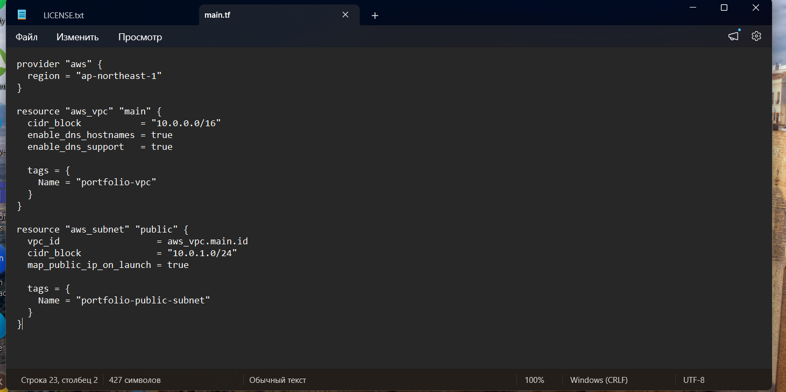

### Apply Result

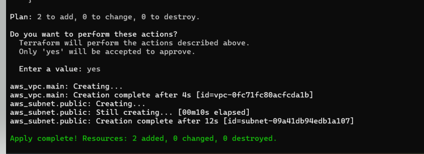

---

# Step 2 — Routing Configuration (Internet Gateway & Route Table)

## 🇯🇵 実施内容
- インターネットゲートウェイ（Internet Gateway）の追加
- デフォルトルート（0.0.0.0/0）を持つルートテーブルの作成
- サブネットとの関連付け

## 🇺🇸 What I did
- Added an Internet Gateway for external connectivity
- Created a Route Table with a default route (**0.0.0.0/0**)
- Associated the Route Table with the public subnet

### Code

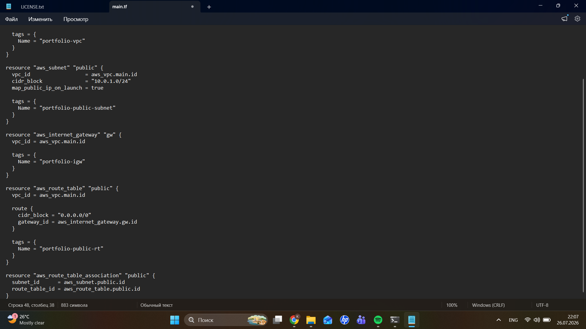

### Apply Result

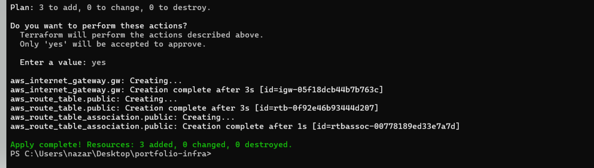

---

# Step 3 — Security Group Configuration

## 🇯🇵 実施内容
- Security Group（portfolio-sg）の作成
- SSH（22）、HTTP（80）、HTTPS（443）のインバウンドルールを設定
- すべてのアウトバウンド通信を許可

## 🇺🇸 What I did
- Created a Security Group (**portfolio-sg**)
- Configured inbound rules for:
  - SSH (22)
  - HTTP (80)
  - HTTPS (443)
- Allowed all outbound traffic

### Code

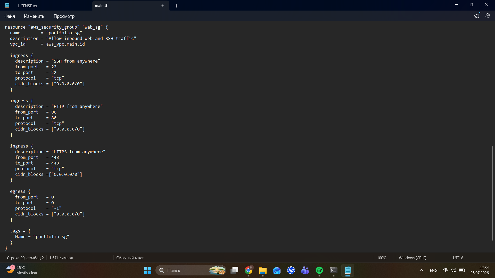

### Apply Result

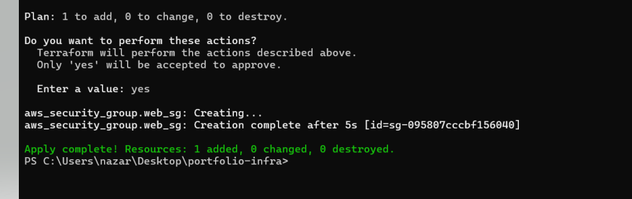

---

# Step 4 — EC2 Instance Deployment

## 🇯🇵 実施内容
- Data Sourceを利用して最新のUbuntu 22.04 LTS AMIを取得
- t3.microインスタンスを作成
- パブリックサブネットおよびSecurity Groupへ接続

## 🇺🇸 What I did
- Retrieved the latest official Ubuntu 22.04 LTS AMI dynamically using Terraform Data Sources
- Provisioned an EC2 t3.micro instance
- Attached the instance to the public subnet and security group

### Code

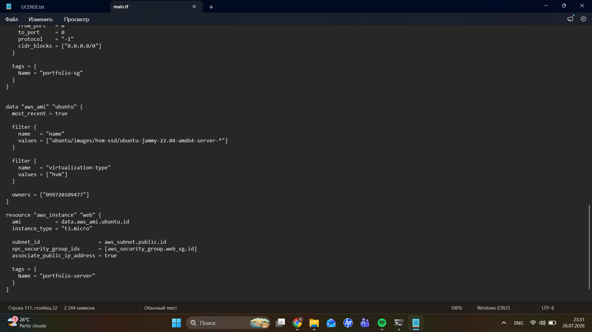

### Apply Result

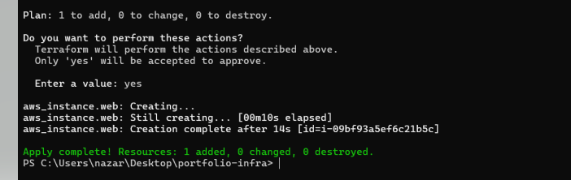

---

# 🚀 Phase 2: Refactoring & Automated Web Deployment | リファクタリングとWebサイトの自動デプロイ

## 🗂️ 1. Code Refactoring | コードのリファクタリング

### 🇺🇸 English
After successfully deploying the initial infrastructure, I realized that keeping all the Terraform code in a single `main.tf` file was a bad practice for maintainability. I decided to refactor the codebase into logical, separate files (e.g., `vpc.tf`, `ec2.tf`, `security.tf`). This makes the infrastructure easier to read, maintain, and scale.

### 🇯🇵 日本語
初期のインフラ構築が成功した後、すべてのTerraformコードを単一の `main.tf` ファイルにまとめておくことは、保守性の観点から良くないプラクティスであることに気づきました。そこで、コードベースを論理的なファイル（例：`vpc.tf`, `ec2.tf`, `security.tf`）に分割（リファクタリング）しました。これにより、インフラの可読性、保守性、拡張性が向上しました。

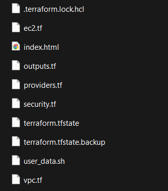

---

## 🌐 2. Web Application Deployment | Webアプリケーションのデプロイ

### 🇺🇸 English
To make the infrastructure actually *do* something, I built a custom interactive portfolio website (HTML/CSS/JS) and deployed it using Nginx.

### 🇯🇵 日本語
インフラを実際に機能させるため、カスタムのインタラクティブなポートフォリオサイト（HTML/CSS/JS）を作成し、Nginxを使用してデプロイしました。

### 🧠 Overcoming the AWS `user_data` Limit | AWS `user_data` の制限の克服

#### 🇺🇸 English
I encountered a major challenge: **AWS has a hard limit of 16KB for the `user_data` script**, and my HTML file was too large to be passed directly.
*   **Solution**: I used Terraform's `base64gzip()` function to compress the HTML file, passed the encoded string to the server, and used a Bash script (`user_data.sh`) to decompress it (`gunzip`) and serve it via Nginx.
*   This demonstrates my ability to debug deployment failures and find workarounds for cloud provider limitations.

#### 🇯🇵 日本語
開発中に大きな課題に直面しました。**AWSの `user_data` スクリプトには16KBの厳格な制限**があり、作成したHTMLファイルはそれを超えていたため、直接渡すことができませんでした。
*   **解決策**: Terraformの `base64gzip()` 関数を使用してHTMLファイルを圧縮し、エンコードされた文字列をサーバーに渡し、Bashスクリプト（`user_data.sh`）内で `gunzip` を使用して解凍してNginxで配信する戦略を実装しました。
*   これは、デプロイの失敗をデバッグし、クラウドプロバイダーの制限に対する回避策を見つける私の能力を証明しています。

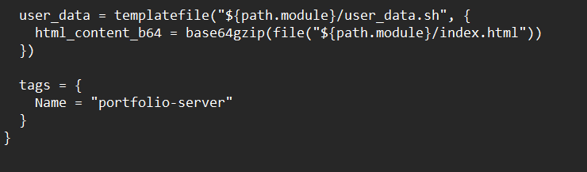
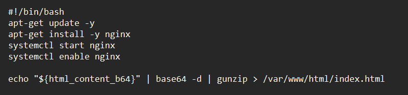

---

## 🌍 3. Live Result | 実行結果

### 🇺🇸 English
The server is configured to automatically install Nginx, unpack the site, and serve it on port 80.

### 🇯🇵 日本語
サーバーは、Nginxのインストール、サイトの解凍、およびポート80での配信を自動的に行うように構成されています。

## 🌐 Live Demo
👉 **[Click here to view the live portfolio website](http://13.192.207.57)**

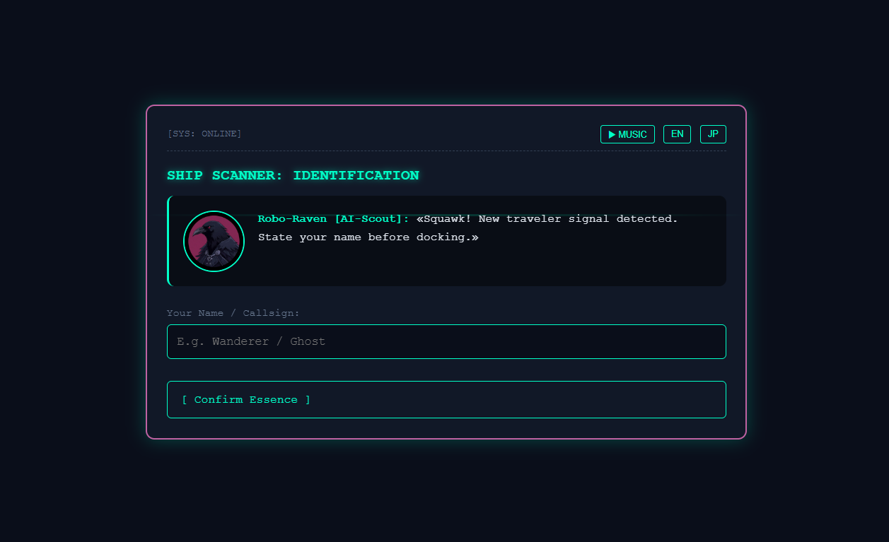

---

# 🛠 Tech Stack | 技術スタック

-   **Cloud**: Amazon Web Services (AWS)
-   **IaC**: Terraform
-   **OS**: Ubuntu Server 22.04 LTS
-   **Web Server**: Nginx
-   **Frontend**: HTML, CSS, Vanilla JavaScript
-   **Scripting**: Bash

---

# 📚 What I Learned | 学んだこと

### 🇺🇸 English
-   **Building AWS infrastructure declaratively with Terraform**: Managing state and planning changes.
-   **Designing cloud networking**: Connecting VPCs, subnets, Internet Gateways, and Route Tables.
-   **Managing network security**: Configuring Security Groups to allow specific traffic.
-   **Refactoring monolithic code**: Splitting `main.tf` into logical files for better maintainability.
-   **Automating server configuration**: Using Bash `user_data` to install Nginx without manual SSH access.
-   **Overcoming infrastructure limits**: Solving the AWS 16KB `user_data` limit using `base64gzip` and `gunzip`.
-   **Applying Infrastructure as Code (IaC) best practices**: Structuring files and documenting the deployment process.

### 🇯🇵 日本語
-   **Terraformによる宣言的なAWSインフラの構築**: ステートの管理と変更計画の手法。
-   **クラウドネットワーキングの設計**: VPC、サブネット、インターネットゲートウェイ、ルートテーブルの接続。
-   **ネットワークセキュリティの管理**: 特定のトラフィックを許可するセキュリティグループの構成。
-   **モノリシックコードのリファクタリング**: 保守性を高めるための `main.tf` から論理ファイルへの分割。
-   **サーバー構成の自動化**: 手動のSSHアクセスなしでNginxをインストールするためのBash `user_data` の使用。
-   **インフラの制限の克服**: `base64gzip` と `gunzip` を使用したAWS 16KB `user_data` 制限の解決。
-   **Infrastructure as Code (IaC) のベストプラクティスの適用**: ファイルの構成とデプロイプロセスの文書化。

- Building AWS infrastructure declaratively with Terraform
- Designing cloud networking using VPCs, subnets, Internet Gateways, and Route Tables
- Managing network security with Security Groups
- Provisioning EC2 instances using Terraform Data Sources
- Applying Infrastructure as Code (IaC) best practices
